<div align="center">

# 🛡️ SafeSphere

### An AI-Enabled, Community-Driven Personal Safety Platform

**Prevent · Detect · Respond** — for Mumbai, Navi Mumbai, Delhi and Pune

Android app · Admin dashboard · ML service · 7 machine-learning components · 100 % free-to-run stack


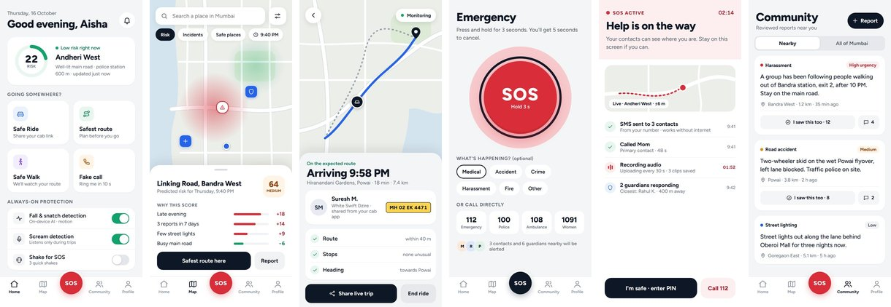

*B.E. Computer Science & Engineering (AI & ML) — Major Project, Lokmanya Tilak College of Engineering, Navi Mumbai · 2026-27*

</div>

---

## 📑 Contents

1. [What is SafeSphere?](#-what-is-safesphere)
2. [Features](#-features)
3. [System architecture](#-system-architecture)
4. [Machine-learning components](#-machine-learning-components)
5. [Results](#-results)
6. [Key workflows](#-key-workflows)
7. [Database design](#-database-design)
8. [Security & privacy](#-security--privacy)
9. [Tech stack](#-tech-stack)
10. [Repository structure](#-repository-structure)
11. [Getting started](#-getting-started)
12. [ML API reference](#-ml-api-reference)
13. [Testing](#-testing)
14. [Limitations & future scope](#-limitations--future-scope)
15. [Team](#-team)

---

## 💡 What is SafeSphere?

Most safety apps are a single SOS button that sends an SMS. But in a real emergency — a fall, a struggle, a snatched phone — the person may not be able to unlock the phone at all; the alert may need internet that isn't there; and nobody nearby knows anything is wrong.

SafeSphere answers three questions:

| Layer | Question | How SafeSphere answers it |
|---|---|---|
| 🟢 **Prevent** | *Is this place, route or time risky for me?* | Hourly street-level risk score with reasons (ML-1) and fastest / balanced / safest routes (ML-2) |
| 🟠 **Detect** | *Is something wrong — even if I can't press a button?* | On-phone scream detection (ML-3), fall & snatch detection (ML-4), cab-ride anomaly detection (ML-5) |
| 🔴 **Respond** | *Who needs help first, and what happened?* | Offline SOS (SMS + call from the SIM), live link, hashed audio evidence, verified guardians within 5 km, triage-ranked admin dashboard (ML-8), report NLP (ML-6) |

<p align="center">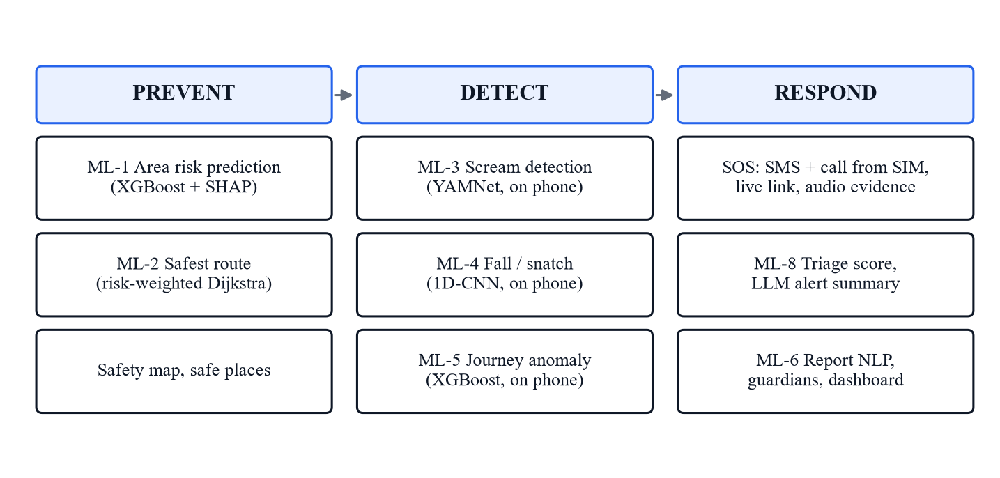</p>

---

## ✨ Features

### 📱 Android app

| Feature | What it does |
|---|---|
| **SOS** | Hold 3 s (or shake, or an AI trigger) → 5 s cancel window → **SMS to every contact and a direct call from the phone's own SIM — works without internet**. Live location every 5 s, 30 s audio evidence chunks with SHA-256 hashes, push to contacts and guardians |
| **Duress PIN** | Entering the duress PIN makes the app *look* resolved while the SOS silently continues |
| **Guard mode** | Arms scream + fall detection anywhere; every AI trigger first asks **"Are you OK?"** (10 s) to avoid false alarms |
| **Safe Ride** | Share the trip from Uber / Ola / Rapido (or paste the link) → driver, plate and destination are parsed → the ride is monitored for detours, long stops, heading away and lateness; the server escalates if the phone goes silent |
| **Safe Walk** | Same monitoring for walks, with an "I'll be there in…" timer |
| **Risk map** | Google-Maps-like OpenStreetMap map with the ML-1 risk heatmap, police stations and hospitals, and an area card with the score and its reasons |
| **Safest route** | Fastest / balanced / safest routes compared by time and risk exposure |
| **Community** | Report incidents (photo, map pin, anonymous option). AI suggests category & urgency and blocks spam/abuse; moderators approve; others confirm ("I saw this too") and comment |
| **Citizen Guardians** | Verified volunteers get SOS alerts within 5 km with "I'm responding / I've arrived / navigate" actions |
| **Fake call** | A realistic incoming call to get out of an uncomfortable situation |
| **Medical card** | Blood group, allergies and conditions shared with responders during an SOS |

### 🖥️ Admin dashboard (web)

| Page | What it does |
|---|---|
| **Live alerts** | Queue sorted by **triage score**, live map, stats, pending reports |
| **Alert detail** | Location trail, timeline, medical card, contacts, evidence playback with hash, "why this priority" breakdown and a one-line **AI summary** |
| **Safe Ride trips** | Every ride/walk being monitored — start, destination, planned route, travelled trail, anomalies |
| **Reports** | Moderation queue with AI category, urgency, toxicity and duplicate hints |
| **Risk map & zones** | ML-1 risk per street hexagon by hour, SHAP reasons on click, admin-drawn safe/unsafe/watch zones |
| **Guardians** | Verify / suspend volunteer guardians |
| **Analytics · AI models** | Trends, response times, model versions and metrics |
| **Public share page** | `/live/<token>` — contacts follow an SOS or a trip without an account; link expires |

---

## 🏗️ System architecture

<p align="center">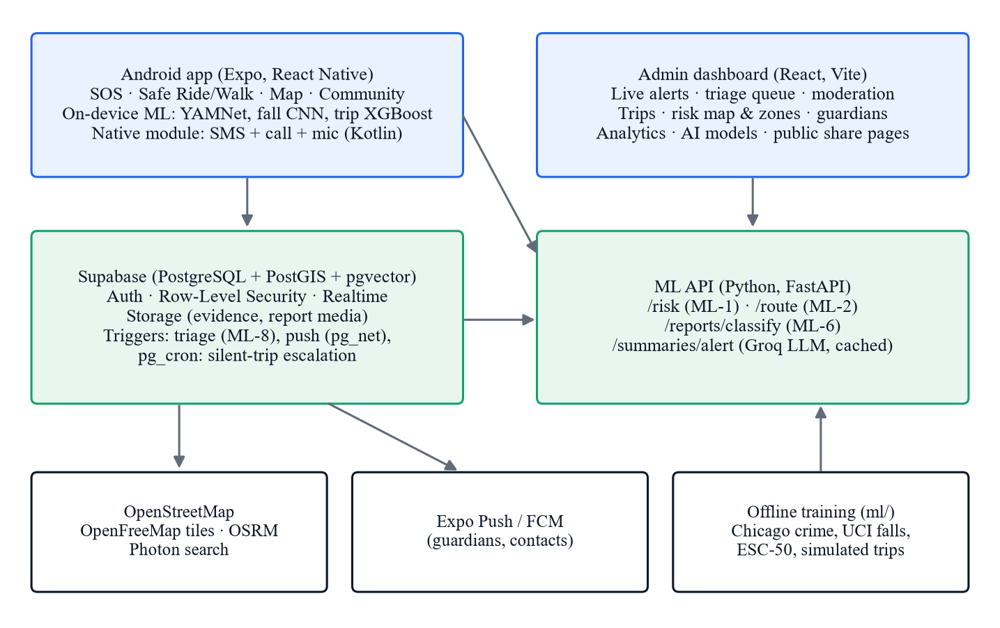</p>

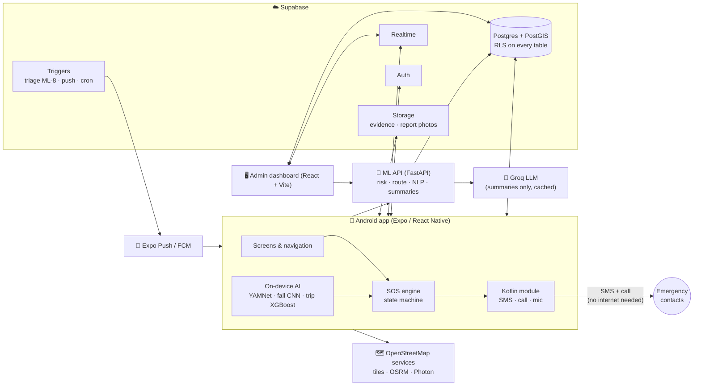

**Design principles**

- **SOS never depends on the network or the LLM.** SMS and calls go straight from the SIM; alert rows are queued offline and synced later; Groq is never on the SOS path.
- **Zero cost.** No Google Maps, no Twilio, no paid APIs — OpenStreetMap, free Supabase, free Groq tier, free Expo builds.
- **Privacy by default.** Audio is analysed in memory on the phone; PINs never leave the device.

---

## 🧠 Machine-learning components

| ID | Component | Model | Runs on | Data |
|---|---|---|---|---|
| **ML-1** | Area risk prediction | XGBoost (Poisson) + SHAP reasons | ML API / DB | 106,279 geolocated street incidents (Chicago open data, 2023–24) + OpenStreetMap features, transferred to Indian cities |
| **ML-2** | Safest route | Risk-weighted Dijkstra | ML API | OSM road graphs of Mumbai-MMR, Delhi, Pune |
| **ML-3** | Scream / distress detection | YAMNet (TFLite) + 2-of-3 vote | 📱 Phone | AudioSet-trained; calibrated on ESC-50 |
| **ML-4** | Fall & snatch detection | 1D-CNN (109 KB TFLite) | 📱 Phone | UCI Simulated Falls & ADL (17 volunteers) |
| **ML-5** | Ride / walk anomaly | XGBoost + 3-fix persistence | 📱 Phone (JS) | 600 simulated Mumbai trips |
| **ML-6** | Report NLP | Word + char TF-IDF, linear SVM | ML API | 1,360 labelled reports (English, Hinglish, Roman Hindi) |
| **ML-8** | Alert triage | Explainable logistic score | Database trigger | Rule-weighted, per-factor breakdown |

<details>
<summary><b>ML-1 · Area risk</b> — how it works</summary>

- Unit: **H3 hexagon, resolution 8** (~0.74 km²) × 24 hours × weekday/weekend.
- Features per cell from OpenStreetMap: shops, eateries, nightlife, banks/ATMs, police, hospitals, schools, fuel, bus stops, rail/metro stations, major/minor road length, intersections, distance to police. Each converted to a **within-city percentile** so the model transfers between cities with different mapping density.
- Target: street incidents per cell-hour. Baseline Poisson GLM vs **XGBoost (Poisson objective)**.
- Output: 0–100 score (percentile within the city) + top-3 **SHAP** reasons such as *"Late night"*, *"Busy bus corridor"*, *"Close to a police station"*.
- 285,360 hourly scores for 5,945 street cells stored in `risk_cells`.
</details>

<details>
<summary><b>ML-2 · Safest route</b> — how it works</summary>

Every edge of the city graph is weighted

```
w(e) = length(e) × (1 + λ · risk(e) / 100)
```

and Dijkstra runs for **λ = 0 (fastest), 1.5 (balanced), 5 (safest)**; identical paths are merged. Each route reports time, distance and length-weighted risk exposure. Graphs are preloaded at startup — a route takes ~0.04 s.
</details>

<details>
<summary><b>ML-3 · Scream detection</b> — how it works</summary>

16 kHz audio from a native Kotlin capture module → YAMNet on a 0.975 s window every 0.5 s → distress score = max(Screaming, Shout, Yell). Triggers when the score ≥ **0.30** in **2 of the last 3** windows. Crying was excluded: during calibration every false alarm came from crying babies. Audio never leaves the phone unless an SOS is active.
</details>

<details>
<summary><b>ML-4 · Fall detection</b> — how it works</summary>

Accelerometer + gyroscope at 25 Hz, 4 s window of |acc| (clipped at 16 g) and |gyro|. When the peak exceeds 1.8 g a 1D-CNN (Conv 32-64-64 → global pooling → dense) scores the window; alarm at p ≥ 0.95. Random Forest on 14 hand-crafted features is the baseline.
</details>

<details>
<summary><b>ML-5 · Ride anomaly</b> — how it works</summary>

Eight features per GPS fix (distance from every expected route, min deviation in 30 s, progress to destination over 60/180 s, stationary time, speed, elapsed vs planned time, progress). XGBoost scores each fix; an alert needs **p ≥ 0.7 for 3 consecutive fixes**. The 400 trees are exported to JSON and evaluated in JavaScript on the phone (parity with Python within 0.01).
</details>

<details>
<summary><b>ML-6 · Report NLP & ML-8 · Triage</b> — how they work</summary>

**ML-6:** calibrated linear SVMs on word 1–2-grams + char 2–5-grams predict category (9), urgency (3) and moderation (ok / spam / abusive). Duplicates: char-n-gram cosine ≥ 0.55 within 500 m and 24 h.

**ML-8:** computed by a database trigger on every alert change:

```
priority = 100 / (1 + e^(−z))
z = −2 + w_type + w_trigger + 2·c_AI + 1.5·risk/100 + 0.8·night + 0.6·low_battery + 1.2·duress
```

Each factor's contribution is stored and shown to admins. A one-line LLM summary is generated once per alert (Groq, cached, template fallback).
</details>

---

## 📊 Results

All results are on **held-out data** with leakage-free splits (time split, grouped by volunteer / trip / generation batch).

| Model | Evaluation | Result | Baseline |
|---|---|---|---|
| ML-1 Area risk | Train 2023 → test 2024 | **ROC-AUC 0.948 · PAI 6.47** · Spearman 0.690 | GLM 0.892 · 5.14 · 0.591 |
| ML-2 Safest route | Mumbai road graph | Dadar → Bandra: risk 95 → 84 for +0.3 km; **0.04 s** | — |
| ML-3 Scream | ESC-50, 2.78 h everyday sound | **0 false prompts / hour** at threshold 0.30 | 1.44 / h at 0.15–0.25 |
| ML-4 Fall | 5-fold, unseen volunteers | **Sensitivity 0.997 · Specificity 0.998 · F1 0.991** | RF F1 0.996 |
| ML-5 Ride anomaly | 150 held-out trips | **97.5 % detected · 4.3 % false-alarm trips** · 80 s | Rules 72.8 % / 13 % · IsoForest 88.9 % / 71 % |
| ML-6 Report NLP | 4-fold grouped CV | **Category macro-F1 0.742** · spam F1 0.80 | 0.636 |
| ML-8 Triage | 5 scenarios | Ranking matches intended priority | — |

<table>
<tr>
<td>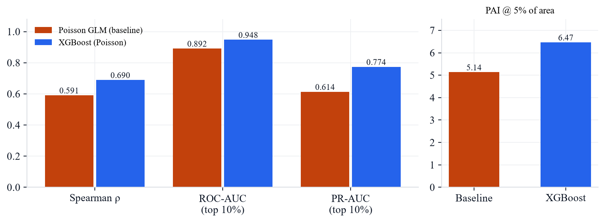</td>
<td>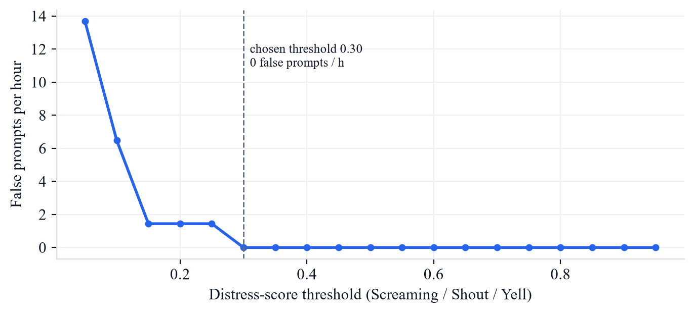</td>
</tr>
<tr>
<td align="center"><sub>ML-1: XGBoost vs Poisson GLM on 2024 data</sub></td>
<td align="center"><sub>ML-3: false prompts per hour vs threshold</sub></td>
</tr>
<tr>
<td>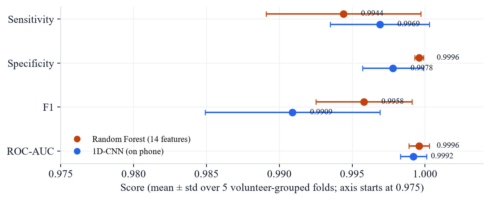</td>
<td>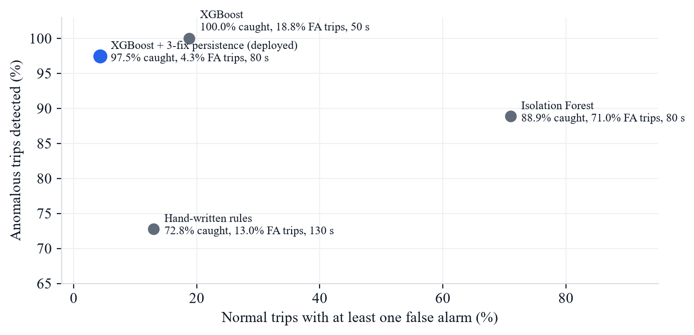</td>
</tr>
<tr>
<td align="center"><sub>ML-4: fall detection, grouped CV</sub></td>
<td align="center"><sub>ML-5: detection vs false-alarm rate</sub></td>
</tr>
</table>

<p align="center">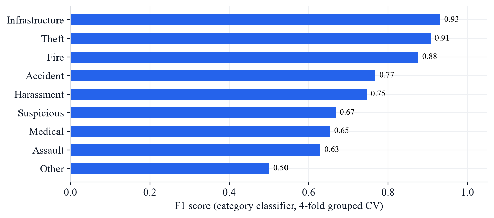<br><sub>ML-6: per-class F1 of the report category classifier</sub></p>

---

## 🔄 Key workflows

### SOS

<p align="center">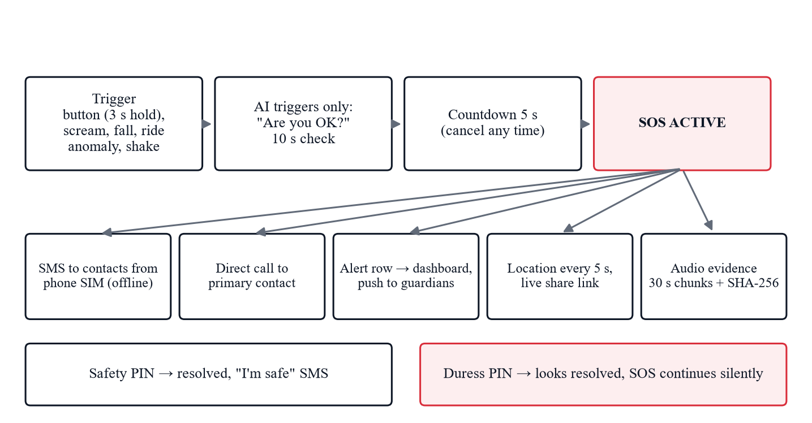</p>

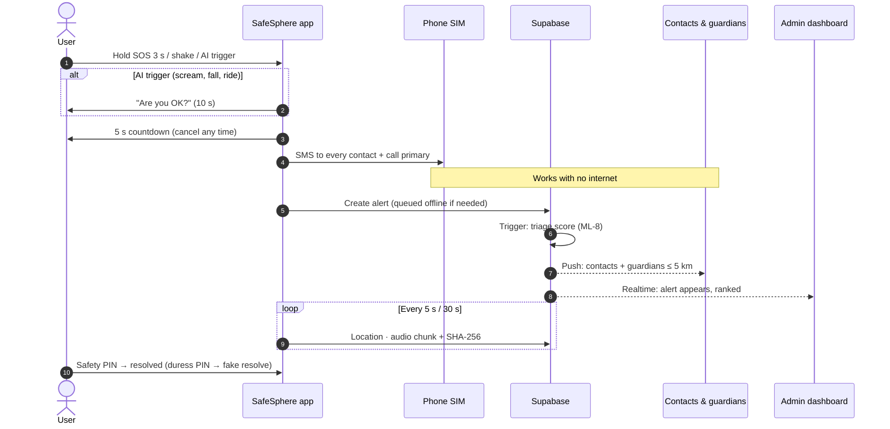

### Safe Ride

<p align="center">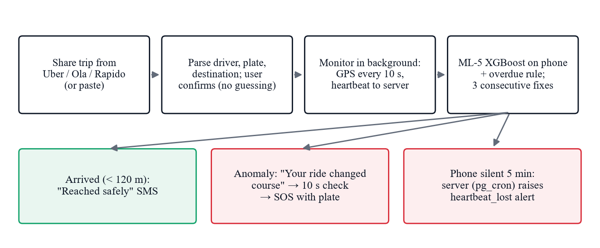</p>

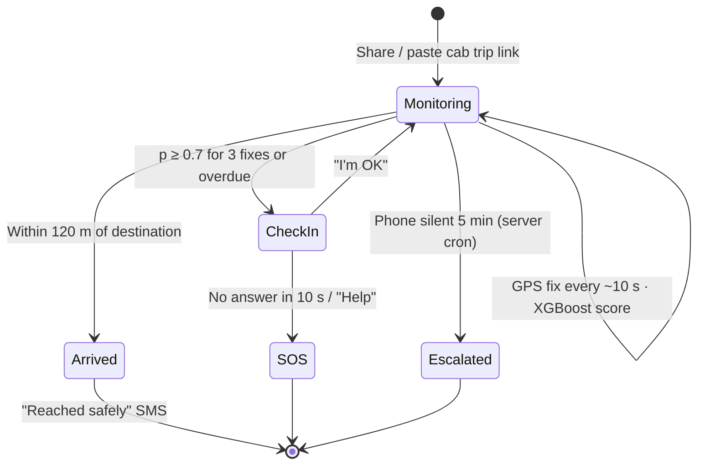

---

## 🗄️ Database design

20 tables in six groups, all with **row-level security**. Locations are PostGIS `geography` points, so radius queries (guardians within 5 km, nearby reports) run inside the database.

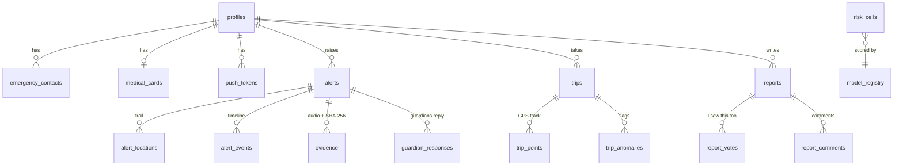

| Group | Tables |
|---|---|
| Users | `profiles`, `medical_cards`, `emergency_contacts`, `push_tokens` |
| SOS | `alerts`, `alert_locations`, `alert_events`, `evidence`, `guardian_responses` |
| Journeys | `trips`, `trip_points`, `trip_anomalies` |
| Community | `reports`, `report_votes`, `report_comments` |
| Places | `safe_places` (8,253 police / hospitals / pharmacies / fuel / metro from OSM), `zones` |
| ML | `risk_cells`, `model_registry`, `llm_cache` |

Migrations (`supabase/migrations`, applied in order):

| # | Migration | # | Migration |
|---|---|---|---|
| 01 | Extensions & enum types | 07 | Feed cursor fix |
| 02 | Tables | 08 | Report policy fix |
| 03 | Functions & triggers | 09 | Alert push notifications (pg_net) |
| 04 | Row-level security | 10 | Risk cells with reasons |
| 05 | Storage & realtime | 11 | Trip heartbeat escalation (pg_cron) |
| 06 | Service-role privileges | 12 | Alert triage score (ML-8) |

---

## 🔐 Security & privacy

| Measure | Detail |
|---|---|
| Row-level security | Users see only their own rows; staff see all; guardians reach alerts only via a radius-limited function |
| Device-only PINs | Safety & duress PINs are salted + hashed in the phone's secure storage — never sent to the server |
| On-device audio | Microphone audio is analysed in memory; uploaded only as SOS evidence |
| Evidence integrity | Every 30 s chunk stored with its SHA-256 hash for tamper detection |
| Expiring links | Live-location pages use random tokens and expire automatically |
| Least privilege | App & dashboard hold only the public key; service key + LLM key stay on the server |
| Secrets hygiene | Keys live only in gitignored `.env` files; every folder ships a `.env.example` |

---

## 🧰 Tech stack

| Layer | Technology |
|---|---|
| Mobile | Expo SDK 57 · React Native 0.86 · TypeScript · Expo Router · Reanimated · TanStack Query |
| Native | Kotlin Expo module (SmsManager, ACTION_CALL, AudioRecord) |
| On-device ML | react-native-fast-tflite (YAMNet, fall CNN) · JS tree evaluator (XGBoost) |
| Maps | MapLibre · OpenFreeMap "liberty" tiles · OSRM routing · Photon search |
| Backend | Supabase: PostgreSQL 17, PostGIS, Auth, Storage, Realtime, pg_net, pg_cron |
| ML service | Python 3.13 · FastAPI · XGBoost · scikit-learn · SciPy · H3 |
| Training | TensorFlow · scikit-learn · XGBoost · SHAP · OSMnx · pyrosm · GeoPandas · MLflow |
| LLM | Groq (gpt-oss) — alert summaries only, cached, template fallback |
| Dashboard | React 19 · Vite · Tailwind CSS v4 · Motion · MapLibre GL · h3-js |
| Notifications & builds | Expo Push + Firebase Cloud Messaging · EAS Build |

---

## 📁 Repository structure

```
safesphere/
├── apps/
│   ├── mobile/                 # Android app (Expo)
│   │   ├── src/app/            #   routes (expo-router)
│   │   ├── src/features/       #   auth · onboarding · sos · detection · map · ride · walk
│   │   │                       #   community · guardian · home · profile
│   │   ├── modules/safesphere-telephony/   # Kotlin: SMS, call, mic capture
│   │   └── assets/models/      #   yamnet.tflite · fall_cnn.tflite · anomaly_model.json
│   └── admin/                  # Admin dashboard + public share pages (React + Vite)
├── services/
│   └── ml-api/                 # FastAPI: /risk /route /reports /summaries /triage /trips
├── ml/                         # Training pipelines (risk, routing, audio, motion, anomaly, nlp)
│   ├── src/safesphere_ml/
│   └── models/                 #   exported artifacts loaded by the ML API
├── supabase/                   # migrations · seed · RLS smoke test · edge functions
├── docs/                       # PLAN.md · images · report · presentation
├── design/mockup/              # approved UI concept screens
├── PRODUCT.md · DESIGN.md
```

---

## 🚀 Getting started

### Prerequisites

Node 20+, Python 3.13 (3.12 for TensorFlow training), an Android phone, and free accounts on **Supabase**, **Expo** and **Groq** (and Firebase for push).

### 1 · Database

```bash
cd supabase
# create a free Supabase project, then apply every file in migrations/ in order
supabase db push            # or paste them into the SQL editor
```

### 2 · ML API

```powershell
cd services/ml-api
python -m venv .venv
.\.venv\Scripts\Activate.ps1
pip install -r requirements.txt
copy .env.example .env      # fill in Supabase + Groq keys
uvicorn app.main:app --host 0.0.0.0 --port 8000
```

Wait for `risk + routing models warmed up` in the log, then open `http://localhost:8000/health`.

> 📶 The phone must reach your PC: same Wi-Fi/hotspot, and allow TCP 8000 in Windows Firewall.

### 3 · Mobile app

```bash
cd apps/mobile
npm install
cp .env.example .env         # Supabase URL + anon key, EXPO_PUBLIC_ML_API_URL=http://<PC-LAN-IP>:8000
npm run build:dev            # one-time: EAS development build (APK) — install on the phone
npx expo start --dev-client --clear
```

JavaScript changes reload instantly (press `r`); a new APK is only needed when native code changes.

### 4 · Admin dashboard

```bash
cd apps/admin
npm install
cp .env.example .env         # VITE_SUPABASE_URL, VITE_SUPABASE_ANON_KEY, VITE_ML_API_URL
npm run dev                  # http://localhost:5173
```

Sign in with an account whose `profiles.role` is `admin` or `moderator`.

### Environment variables

| App | Variable | Purpose |
|---|---|---|
| mobile | `EXPO_PUBLIC_SUPABASE_URL`, `EXPO_PUBLIC_SUPABASE_ANON_KEY` | Supabase project (public key only) |
| mobile | `EXPO_PUBLIC_ML_API_URL` | ML API base URL (PC LAN IP in development) |
| mobile | `EXPO_PUBLIC_SHARE_BASE_URL` | Deployed dashboard URL for `/live/<token>` links |
| admin | `VITE_SUPABASE_URL`, `VITE_SUPABASE_ANON_KEY`, `VITE_ML_API_URL` | Same, for the dashboard |
| ml-api | `SUPABASE_URL`, `SUPABASE_SERVICE_ROLE_KEY`, `DATABASE_URL` | Server-side database access |
| ml-api | `GROQ_API_KEY`, `GROQ_MODELS`, `GROQ_REQUESTS_PER_MINUTE` | LLM summaries (rotates models, respects limits) |
| ml-api | `ALLOWED_ORIGINS`, `MODEL_DIR` | CORS and model artifact folder |

### Training the models (optional)

The trained artifacts are already in `ml/models` and `apps/mobile/assets/models`. To retrain, see [`ml/README.md`](ml/README.md); each pipeline lives in `ml/src/safesphere_ml/<risk|routing|audio|motion|anomaly|nlp>/` and logs to MLflow.

---

## 🔌 ML API reference

| Method | Endpoint | Purpose |
|---|---|---|
| `GET` | `/health` | Service status |
| `POST` | `/risk` | Risk score (0–100), level and SHAP reasons for a point and hour (ML-1) |
| `POST` | `/route` | Fastest / balanced / safest routes with risk exposure (ML-2) |
| `POST` | `/reports/classify` | Category, urgency, toxicity and duplicate hint for a report (ML-6) |
| `POST` | `/triage` | Priority score with per-factor breakdown (ML-8) |
| `POST` | `/trips/anomaly` | Journey anomaly probability for a trip window (ML-5) |
| `POST` | `/summaries/alert` | One-line dispatcher summary (Groq, cached, template fallback) |

Interactive docs: `http://<host>:8000/docs`.

---

## 🧪 Testing

| Suite | Count | Covers |
|---|---|---|
| Mobile (Jest) | 50 tests | SOS state machine, SMS builder, phone validation, onboarding rules, cab share-text parser, anomaly rules, PCM decoding, detector voting, JS ↔ Python model parity |
| ML API (pytest) | 18 tests | Endpoints, Groq fallback, synthetic city where the safest route must avoid a high-risk cell |
| Database | 9 checks | RLS smoke test in a rolled-back transaction: no cross-user reads, no self-promotion to admin, share links reveal only a first name |

```bash
cd apps/mobile && npm test && npm run typecheck && npm run lint
cd services/ml-api && pytest -q
cd apps/admin && npm run build && npm run lint
```

---

## ⚠️ Limitations & future scope

**Honest limitations**

- **ML-1** measures incident *density* (busy places score high), not risk per person — open footfall data doesn't exist; it is trained on another city and transferred via OSM.
- **ML-4 / ML-5** use simulated falls (young volunteers, mats) and simulated trips; real-world accuracy will be lower — hence the "Are you OK?" check on every trigger.
- **ML-6** training reports are LLM-drafted; urgency (0.46) and abuse detection (F1 0.28) are weak, so moderators review every report.

**Next semester**

<p align="center">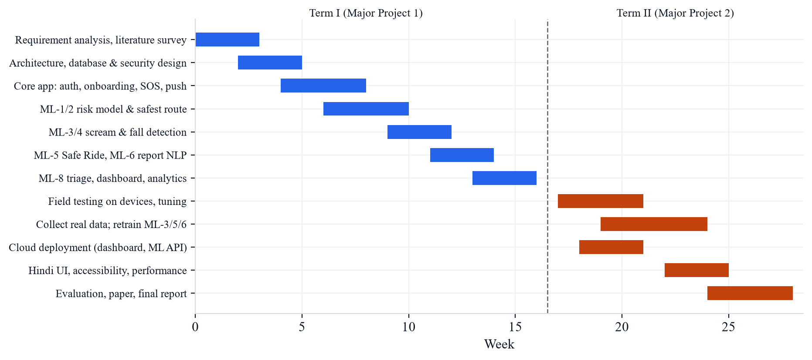</p>

- Deploy the dashboard (Vercel) and ML API to the cloud; over-the-air app updates
- Field testing on several Android phones; tune detectors and battery use
- Collect consented real screams, trips and reports; retrain ML-3, ML-5, ML-6
- Hindi interface, MuRIL for Indian-language reports, wearable support, 112 integration

---

## 👥 Team

| Name | Roll no. |
|---|---|
| Aaditya Dubey | 115 |
| Shrey Gadhave | 116 |
| Shreya Kargutkar | 123 |
| Siddhi Sathe | 142 |

**Guide:** Prof. Ujjwala Pandharkar · **HOD:** Dr. Chaitrali Chaudhari · **Principal:** Dr. Subhash Shinde
Department of Computer Science & Engineering (AI & ML), Lokmanya Tilak College of Engineering, Koparkhairane, Navi Mumbai.

<sub>Map data © OpenStreetMap contributors · Tiles by OpenFreeMap · Crime data: City of Chicago Data Portal · Audio model: YAMNet (Google, AudioSet) · Fall data: UCI Machine Learning Repository.</sub>

<div align="center">

**More:** [Project plan](docs/PLAN.md) · [Product](PRODUCT.md) · [Design system](DESIGN.md) · [ML pipelines](ml/README.md) · [ML API](services/ml-api/README.md) · [Database](supabase/README.md)

</div>
